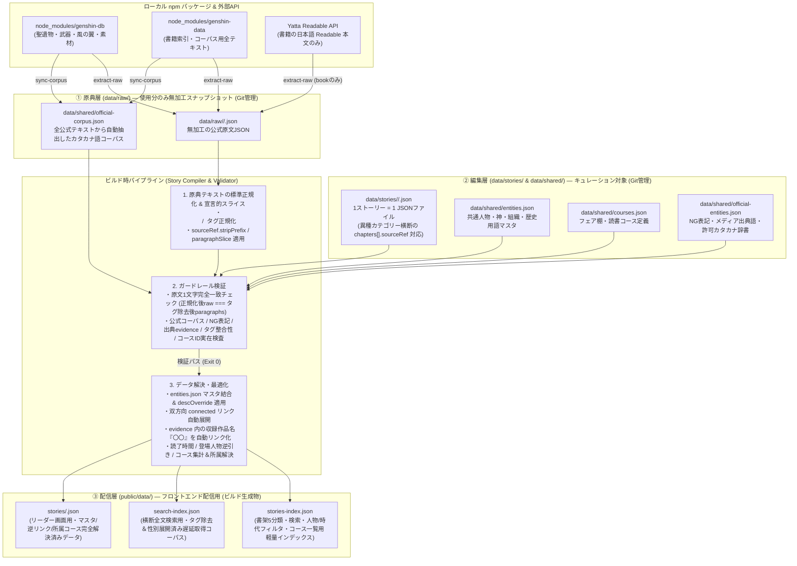
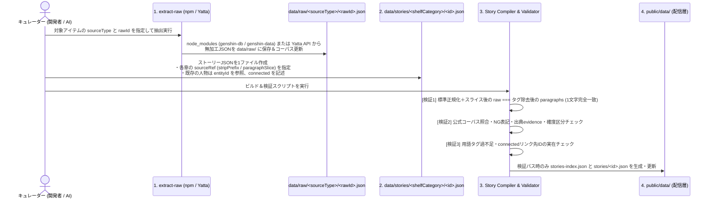

# 「テイワット文庫」データアーキテクチャ設計書（改訂確定版）

本ドキュメントは、初期プロトタイプ（単一HTML版）で検証したコアUXを土台に、npm レジストリ上の原神データパッケージ（`genshin-db` / `genshin-data`）の全カテゴリー調査結果と設計レビューでの決定事項を反映した、データアーキテクチャ設計書である。

---

## 1. 設計レビューで確定した5大アーキテクチャ方針

| 決定領域 | 確定した設計方針 |
| :--- | :--- |
| **① 収録カテゴリーとオムニバス編成** | 基本の長文5種（書籍・聖遺物・武器・突破素材・風の翼）に加え、短〜中文カテゴリーは **`material`（武器突破素材・週ボス素材・突破宝石・精錬素材 等）のみ**を対象とし、**「複数アイテムを1冊の連作（章）として束ねる形式」**として収録可能にする。 |
| **② 書架UIカテゴリー（5分類）と原典種別の分離** | 書架（一覧画面）のUIタブは **`book`（書籍）/ `artifact`（聖遺物）/ `weapon`（武器）/ `attire`（風の翼）/ `chronicle`（突破・育成素材）** の5分類とし、章ごとの原典データ種別（`chapters[].sourceRef.sourceType`）と分離する。 |
| **③ 原典データ（Layer 1）の取得とスナップショット管理** | GitHub Raw への直接HTTP通信を廃止し、`devDependencies` の **`genshin-db` と `genshin-data` からローカル抽出**する（書籍の Readable 本文のみ Yatta API から取得）。**ゲーム本編で正式に入手・閲覧可能な実装済みテキストのみを収録対象とし**、未実装書籍および未実装巻の本文は `data/raw/`・`data/stories/` ともに収録しない。作品で使用した原典データのみを無加工のまま `data/raw/<sourceType>/<rawId>.json` に切り出して Git 管理する。 |
| **④ 定型文・制御タグの宣言的クレンジングと1文字一致検証** | `data/raw/` には無加工データを保存し、検証時に **「① 装飾タグ（`<br/>`, `<color>` 等）の標準正規化 → ② `sourceRef` で宣言した定型プレフィックス除去（`stripPrefix`）または段落スライス（`paragraphSlice`）」** を経た文字列と、本文（`paragraphs` の注釈タグ除去後）が **100%完全一致** することを機械検証する。 |
| **⑤ 共通人物マスタ・双方向リンク・出典自動リンク化** | 人物・用語マスタ（`entities.json`）を `entityId` で参照可能にし（文脈に応じた `descOverride` 可）、`connected` は片方向記述からビルド時に双方向リンクを自動展開する。`evidence` は執筆しやすい文字列形式を維持しつつ、収録済み作品名『〇〇』が含まれる場合はビルド時に自動リンク化する。 |

---

## 2. npm データソース全調査に基づく原典マッピング

npm レジストリ上の `genshin-db@5.2.15` と `genshin-data@0.65.1` は収録カテゴリーとフィールドに明確な住み分けがある。本アーキテクチャでは両パッケージを `devDependencies` として併用し、以下のマッピングで原典層（`data/raw/`）へ抽出する。

### 2.1 長文ストーリー（`story` フィールド / Readable本文）を持つカテゴリー
1アイテム（または1セット）単体で1冊の読み物になる主役カテゴリー。

| `sourceType` | 取得元パッケージ / API | JP収録数 | 抽出フィールド | 特徴・文字数実態 |
| :--- | :--- | :---: | :--- | :--- |
| **`artifact`**<br>（聖遺物） | `genshin-db`<br>(`artifacts`) | 63 セット | 各部位（`flower`, `plume`, `sands`, `goblet`, `circlet`）の `description` ＆ `story` | 1部位平均455〜522字（最大3,164字）。`genshin-data` には `story` が無いため必ず `genshin-db` を使用する。 |
| **`weapon`**<br>（武器） | `genshin-db`<br>(`weapons`) | 256 件<br>(`story`有 246件) | `description` ＆ `story` | 平均772字（最大2,251字）。`genshin-data` には `story` が無いため必ず `genshin-db` を使用する。 |
| **`windglider`**<br>（風の翼） | `genshin-db`<br>(`windgliders`) | 19 件 | `description` ＆ `story` | 全19件に長文 `story` あり（平均908字、最大1,593字）。`genshin-data` にはカテゴリー自体が存在しない。 |
| **`book`**<br>（書籍） | `genshin-data` (`books`)<br>＋ **Yatta Readable API** | 619 シリーズ<br>(1,224 巻) | `volumes[].description`（要約）＋ Yatta API `readable/Book<storyId>`（本文） | npm パッケージには `storyId` と要約しか無いため、抽出スクリプトで Yatta API から各巻本文を結合して `data/raw/book/` に保存する。 |

### 2.2 連作・オムニバス・出典対象となる短〜中文カテゴリー（`description`）
単体では100〜500字程度のため、**複数段階の連作**（突破素材★2〜★5、週ボス育成素材3種、元素宝石など）として編纂するカテゴリー。本アーキテクチャで扱う `sourceType` は **`material` のみ**に限定する。

| `sourceType` | 取得元パッケージ | JP収録数 | 抽出フィールドと定型文の特徴 |
| :--- | :--- | :---: | :--- |
| **`material`**<br>（突破素材・週ボス素材・突破宝石・精錬素材 等） | `genshin-db`<br>(`materials`) | 921 件 | `description` を抽出。<br>・**武器突破素材**（96件＝24シリーズ×4段階、最大536字）：冒頭に `"武器に突破の力を付与する材料。\n"` あり<br>・**キャラクター育成素材／週ボス素材**（91件、最大347字）<br>・**精錬素材**（27件、最大358字）：冒頭に `"「〇〇」専用の精錬アイテム。\n"` あり<br>・**キャラクター突破素材／元素宝石**（32件、最大133字）：冒頭に `"キャラクターの突破用アイテム。\n"` あり<br>・**キャラクター天賦素材**（73件、最大141字）：冒頭に `"天賦育成素材。\n"` あり |

> [!NOTE]
> **対象外としたその他カテゴリーの扱い**
> `enemies` / `monsters`（敵・魔物図鑑）・`outfits`（衣装）・`tcg_action` / `tcg_monsters`（七聖召喚）・`furnishing`（調度品）・`geographies`（展望ポイント）・`namecards`（名刺）・`domains`（秘境）等は、ストーリー本編の `sourceType` には含めず、必要に応じて `official-corpus.json`（公式カタカナコーパス）や用語解説執筆時の裏付け調査資料としてのみ参照する。

---

## 3. 全体アーキテクチャ：3層データモデル（Raw / Curation / Dist）

データを **「① 原典層（Raw）」「② 編集層（Curation）」「③ 配信層（Dist）」** の3層に分離し、ビルド時の **Story Compiler & Validator** で検証・解決・分割出力する。



### ディレクトリ構成

```text
genshin-books/
├── data/
│   ├── schemas/
│   │   ├── story.schema.json             # 編集層ストーリーJSONのJSON Schema定義
│   │   ├── entities.schema.json          # 共通人物・用語マスタのJSON Schema定義
│   │   └── courses.schema.json           # フェア棚・読書コース定義のJSON Schema定義
│   │
│   ├── raw/                              # 【① 原典層】作品で使用したアイテムの無加工スナップショット
│   │   ├── artifact/
│   │   │   └── crimsonwitchofflames.json
│   │   ├── weapon/
│   │   │   └── elegyfortheend.json
│   │   ├── windglider/
│   │   │   └── wingsoffatescourseintertwined.json
│   │   ├── material/
│   │   │   ├── fettersofthedandeliongladiator.json
│   │   │   ├── ashenheart.json
│   │   │   ├── hellfirebutterfly.json
│   │   │   └── moltenmoment.json
│   │   └── book/
│   │       └── the_byakuyakoku_collection.json
│   │
│   ├── shared/                           # 【② 編集層：共通マスタ】
│   │   ├── entities.json                 # 作品横断の人物・神・組織・歴史用語マスタ
│   │   ├── courses.json                  # フェア棚・読書コース定義（全11コース）
│   │   ├── official-entities.json        # NG表記・メディア出典語・一般カタカナ辞書
│   │   └── official-corpus.json          # genshin-db + genshin-data 全量から生成した公式カタカナ辞書
│   │
│   └── stories/                          # 【② 編集層：ストーリー単位データ】UIの5分類フォルダで整理
│       ├── book/                         # 書籍（古文書・禁書）
│       │   └── byakuyakoku.json
│       ├── artifact/                     # 聖遺物（連作短編）
│       │   ├── crimson_witch.json
│       │   ├── pale_flame.json
│       │   └── husk.json
│       ├── weapon/                       # 武器（短編小説）
│       │   ├── elegy.json
│       │   ├── oathsworn.json
│       │   └── wolfs.json
│       ├── attire/                       # 風の翼
│       │   └── wings_of_fate.json
│       └── chronicle/                    # 突破・育成素材（突破素材四幕詩・週ボス素材/突破宝石の連作）
│           ├── distant_sea.json
│           ├── dandelion.json
│           └── signora_chronicle.json
│
└── public/
    └── data/                             # 【③ 配信層】ビルド出力（フロントエンドが fetch する静的JSON）
        ├── stories-index.json            # 書架一覧・フィルタ用（本文なし・軽量）
        ├── search-index.json             # 横断全文検索用コーパス（フォーカス/検索時に遅延取得）
        └── stories/
            ├── byakuyakoku.json          # リーダー画面用（すべて解決済み）
            └── ...
```

---

## 4. 編集層（Layer 2）の詳細スキーマ設計

### 4.1 書架UIカテゴリー（`shelfCategory`）の5分類定義

フロントエンドの書架タブ（ホログラムアイコン）と対応する5つの識別子を定義する。表示ラベルをコード内にハードコードせず、識別子で制御する。

| `shelfCategory` ID | 書架タブ名 | サブタイトル表記（`categoryLabel` デフォルト値） | 主な収録対象 |
| :--- | :--- | :--- | :--- |
| **`book`** | 書籍 | `書籍（古文書・禁書）` | 書籍シリーズ全巻（『白夜国館蔵』『竹林月夜』等） |
| **`artifact`** | 聖遺物 | `聖遺物（連作短編）` | 聖遺物5部位を時系列再構成した全5章の物語 |
| **`weapon`** | 武器 | `武器（短編小説）` | 武器1振りの長文ストーリー |
| **`attire`** | 風の翼 | `風の翼（短編・銘文）` | 風の翼（`windglider`）の長文ストーリー |
| **`chronicle`** | 突破・育成素材 | `突破素材（四幕詩）` / `育成素材（連作）` | 武器突破素材4段階連作（`material`）、週ボス育成素材3種連作（`material`）、突破宝石連作（`material`）など |

---

### 4.2 共通人物・用語マスタ（`data/shared/entities.json`）

複数作品に登場する人物・神・組織・歴史用語を定義する。

```json
{
  "rosalyne": {
    "name": "ロザリン（淑女）",
    "kind": "character",
    "defaultIdentity": "正体：ファデュイ執行官第八位『淑女』（ロザリン・クルーズチカ・ローエファルタ）",
    "defaultDesc": "500年前のモンド出身の魔女。恋人と故郷を奪った魔物を焼き尽くすため、自らの身体を液体の炎へと変えました。",
    "defaultEvidence": "聖遺物『燃え盛る炎の魔女』・『蒼白の炎（無垢の花）』・週ボス育成素材『溶滅の刻』『灰燼の心』"
  },
  "rustan": {
    "name": "ルースタン",
    "kind": "character",
    "defaultIdentity": "正体：西風騎士団の騎士「ルースタン」（幼い狼）",
    "defaultDesc": "500年前の西風騎士団を実質的に支えていた騎士であり、ロザリンの恋人。災厄の戦いで命を落としました。",
    "defaultEvidence": "聖遺物『守護の心』・武器『西風剣』『終焉を嘆く詩』"
  }
}
```

---

### 4.3 ストーリーJSON（`data/stories/<shelfCategory>/<id>.json`）の完全スキーマ

各章（`chapters[]`）が自身の `sourceRef` を持つことで、**単一アイテムの作品**も**異種カテゴリー横断のオムニバス作品**もまったく同じスキーマで表現・検証できる。ゲーム内で第1巻のみ正式実装されている書籍等向けに、任意配列 `"unreleasedVolumes"`（各要素 `sourceRef`（`field: "description"`）・`partLabel`・`description`）を定義でき、本編文字数・読了目安・章数からは除外しつつ原典1文字一致・公式コーパス検証および横断検索の対象となる。
また、必須フィールド `"addedAt": "YYYY-MM-DD"` を設定することで、書架の「新着順」並び替えや追加から14日以内かつ未読の `NEW` バッジ表示、さらに配信 HTML の JSON-LD `datePublished` および `sitemap.xml` `<lastmod>` に反映される（`story.schema.json` の必須項目。ビルド時に実在日付形式を検証し `stories-index.json`・個別配信JSON へ引き継ぐ）。あわせて検索タイトル・ディスクリプションを個別調整したい場合向けに任意オブジェクト `"seo": { "title": "...", "description": "..." }` を許容しており、公式コーパス検証を経た上で配信JSONへ透過される。

#### 例1：聖遺物（単一セットの時系列再構成）— `data/stories/artifact/crimson_witch.json`

```json
{
  "$schema": "../../schemas/story.schema.json",
  "id": "crimson_witch",
  "title": "燃え盛る炎の魔女",
  "shelfCategory": "artifact",
  "categoryLabel": "聖遺物（連作短編）",
  "region": ["モンド", "スメール"],
  "era": "500年前の災厄",
  "addedAt": "2026-11-01",
  "hook": "愛する人を失った少女は、涙が枯れた日に自らの身体を「液体の炎」へと変えた——",
  "tags": ["ロザリン（淑女）", "500年前の災厄", "全5章・時系列順"],
  "preGuide": [
    "舞台：今から約500年前、テイワット全土を魔物の大群が襲った「漆黒の災厄」の時代。",
    "主人公：モンドからスメールの教令院へ留学していた、歌と炎の魔法を愛する少女。",
    "読みどころ：5つの部位にバラバラに書かれている記憶を、時系列順に並べています。"
  ],
  "overallTruth": "この魔女こそ、後にファデュイ執行官第八位『淑女（シニョーラ）』となる女性、ロザリン・クルーズチカ・ローエファルタです。…",
  "gameEffect": "2セット：炎元素ダメージ+15%。 / 4セット：過負荷、燃焼、烈開花反応によるダメージ+40%…",
  "connected": [
    {
      "targetId": "elegy",
      "relation": "対になる裏視点の物語（武器：終焉を嘆く詩）",
      "desc": "『終焉を嘆く詩』——彼女に水時計を贈り、モンドで帰りを待ちながら戦死した恋人ルースタンの最期",
      "reverseRelation": "対になる表視点の物語（聖遺物：燃え盛る炎の魔女）",
      "reverseDesc": "『燃え盛る炎の魔女』——戦死した騎士ルースタンを想い、自らを液体の炎へと変えた少女ロザリンの物語"
    }
  ],
  "glossary": {
    "cw_lover": {
      "entityId": "rustan",
      "term": "時計をくれた人",
      "descOverride": "ロザリンの恋人であり、彼女がスメールへ留学する際に水時計を贈った西風騎士。"
    },
    "cw_girl": {
      "entityId": "rosalyne",
      "term": "燃える魔女がまだ少女"
    }
  },
  "chapters": [
    {
      "sourceRef": {
        "package": "genshin-db",
        "sourceType": "artifact",
        "rawId": "crimsonwitchofflames",
        "piece": "sands"
      },
      "partLabel": "第一章（時の砂：魔女の破滅の時）",
      "heading": "静止した水時計",
      "epigraph": "かつて炎の魔女が着用していた時計。その中に流れるのは彼女が捧げた歳月である。",
      "paragraphs": [
        "すべての虫を焼き払い、世の中の歪みを焼き尽くすことを夢見た魔女がいた。…",
        "時間はその水時計の中で静かに流れ、{{cw_lover|時計をくれた人}}への想いを刻んでいた。…"
      ],
      "chapterNote": "彼女がスメールへの留学から戻った時、恋人はすでに災厄との戦いで命を落としていました。"
    }
  ]
}
```

#### 例2：複数素材を束ねる連作オムニバス（週ボス育成素材3種）— `data/stories/chronicle/signora_chronicle.json`

> [!NOTE]
> 以下のJSON例は構造イメージを示した設計例であり、実データでは `rawId`（`ashenheart` / `hellfirebutterfly` / `moltenmoment`）や公式名称（『獄炎の蝶』）、時系列順の幕並び、および各章の `stripPrefix`（冒頭定型文の除去宣言）を正確に指定する。

```json
{
  "$schema": "../../schemas/story.schema.json",
  "id": "signora_chronicle",
  "title": "紅蓮の蛾と灰燼の追憶（淑女討伐録）",
  "shelfCategory": "chronicle",
  "categoryLabel": "育成素材（週ボス素材連作）",
  "region": ["稲妻", "スネージナヤ", "モンド"],
  "era": "500年前の災厄〜現代",
  "addedAt": "2026-11-17",
  "hook": "氷の邪眼が砕け散る最期の瞬間、傲慢な『淑女』は500年前の純白の夢と彼の名を思い出した——",
  "tags": ["ロザリン（淑女）", "道化（ピエロ）", "週ボス育成素材3部作"],
  "preGuide": [
    "舞台：500年前の災厄から、現代・稲妻の天守閣での決戦まで。",
    "構成：週ボス育成素材3種（『灰燼の心』『獄炎の蝶』『溶滅の刻』）を時系列順に編纂しています。",
    "読みどころ：聖遺物『燃え盛る炎の魔女』では明かされなかった彼女の本名「ロザリン」と、最期の瞬間に見た夢が直接語られます。"
  ],
  "overallTruth": "聖遺物『燃え盛る炎の魔女』と『蒼白の炎（無垢の花）』の完結編にあたる公式記録群です。…",
  "gameEffect": "週ボス「淑女」（Lv.70以上）挑戦報酬素材『灰燼の心』『獄炎の蝶』『溶滅の刻』。",
  "connected": [
    {
      "targetId": "crimson_witch",
      "relation": "500年前の発端（聖遺物：燃え盛る炎の魔女）",
      "desc": "『燃え盛る炎の魔女』——彼女がなぜ自らの身体を液体の炎へと変えたのか",
      "reverseRelation": "500年後の最期と真実（伝承：紅蓮の蛾と灰燼の追憶）",
      "reverseDesc": "『紅蓮の蛾と灰燼の追憶（淑女討伐録）』——天守閣で討たれた『淑女』が最期に見た純白の夢"
    }
  ],
  "glossary": {
    "sg_jester": {
      "entityId": "pierro",
      "term": "最初の愚者"
    }
  },
  "chapters": [
    {
      "sourceRef": {
        "package": "genshin-db",
        "sourceType": "material",
        "rawId": "ashenheart",
        "field": "description",
        "stripPrefix": "本来の力を発揮した「淑女」を倒して手に入れた、大きな力を秘めた異形の欠片。\n"
      },
      "partLabel": "第一幕（育成素材：灰燼の心）",
      "heading": "最初の愚者に見出された日",
      "epigraph": "本来の力を発揮した「淑女」を倒して手に入れた、大きな力を秘めた異形の欠片。",
      "paragraphs": [
        "涙でさえも炎をかき消すことはできない。…\n彼女の心が永遠の火に焼かれる前に、{{sg_jester|最初の愚者}}が彼女を見つけ出した。…"
      ]
    },
    {
      "sourceRef": {
        "package": "genshin-db",
        "sourceType": "material",
        "rawId": "hellfirebutterfly",
        "field": "description",
        "stripPrefix": "本来の力を発揮した「淑女」を倒して獲得した、大きな力を秘めた異形の欠片。\n"
      },
      "partLabel": "第二幕（育成素材：獄炎の蝶）",
      "heading": "氷の封印と忘れ去られた本名",
      "epigraph": "本来の力を発揮した「淑女」を倒して獲得した、大きな力を秘めた異形の欠片。",
      "paragraphs": [
        "氷の封印が解かれ、過去の意志が蒼白の牢獄を突き破った。…"
      ]
    },
    {
      "sourceRef": {
        "package": "genshin-db",
        "sourceType": "material",
        "rawId": "moltenmoment",
        "field": "description",
        "stripPrefix": "本来の力を発揮した「淑女」を倒して手に入れた、大きな力を秘めた異形の欠片。\n"
      },
      "partLabel": "第三幕（育成素材：溶滅の刻）",
      "heading": "純白の夢からの目覚め",
      "epigraph": "本来の力を発揮した「淑女」を倒して手に入れた、大きな力を秘めた異形の欠片。",
      "paragraphs": [
        "「私は長い夢を見た。」\n「夢の中では、私たちが作った純白の世界で、あんたと再会した。」…"
      ]
    }
  ]
}
```

### 4.4 読書コース定義（`data/shared/courses.json`）

複数の物語を推奨順とネタバレなし 1 行順路ガイドで束ねるキュレーション定義配列（スキーマ：[`data/schemas/courses.schema.json`](../../data/schemas/courses.schema.json)）。

- **必須フィールド**: `id`（`^[a-z0-9_]+$`）、`kind`（`"beginner" | "character" | "arc"`）、`badge`、`title`、`subtitle`、`hook`、`steps`（1件以上の `{ storyId, note }` 配列。`note` はネタバレを含まない1行の順路ガイド）
- **任意フィールド**: `featured`（boolean — `true` のコースを最大3件、書架フェア棚に代表展示）、`seo`（`{ title?, description? }`）

---

## 5. 原典参照（`sourceRef`）と宣言的クレンジング・原文一致検証の仕様

「原文を一字一句改変しない」という絶対ルールと、「ゲーム内のシステム定型文（『武器に突破の力を付与する材料。』等）やHTMLタグを除去して小説として自然に表示する」という要求を両立するため、以下の宣言的検証パイプラインを定義する。

### 5.1 `sourceRef` のスキーマ定義

```typescript
interface ChapterSourceRef {
  /** 取得元パッケージまたはAPI */
  package: "genshin-db" | "genshin-data" | "yatta";
  /** 原典カテゴリー（data/raw/<sourceType>/<rawId>.json に対応） */
  sourceType:
    | "artifact"
    | "weapon"
    | "windglider"
    | "book"
    | "material";
  /** data/raw/ 内のファイルID */
  rawId: string;
  /** 聖遺物の場合のみ指定 */
  piece?: "flower" | "plume" | "sands" | "goblet" | "circlet";
  /** 書籍の場合のみ指定（対象巻のvolumeId） */
  volumeId?: number;
  /** 抽出対象フィールド（省略時は artifact/weapon/windglider は "story"、book は "text"、material は "description"） */
  field?: "story" | "description" | "text";
  /** 原典冒頭から除去するシステム定型文（完全一致する先頭文字列のみ除去を許可） */
  stripPrefix?: string;
  /** 原典の段落配列（空行または改行区切り）から特定範囲 [startIndex, endIndex] のみを章として切り出す場合のスライス指定 */
  paragraphSlice?: [number, number];
}
```

### 5.2 原文1文字完全一致検証アルゴリズム（Story Validator）

ビルド・検証スクリプトは、すべての章に対して以下の変換を行い、**`expectedPlainText === actualPlainText`** であることを検査する。1文字でも異なればビルドエラー（Exit 1）とする。

```javascript
/**
 * 1. data/raw/<sourceType>/<rawId>.json から生テキストを取り出し、
 *    標準サニタイズ (sanitizeRawSourceText) と sourceRef の宣言的スライスを適用した「期待される原文」を生成する
 */
function sanitizeRawSourceText(rawText, { stripPrefix, paragraphSlice } = {}) {
  // Step A: 標準装飾タグのサニタイズ（文字自体は一切変更しない）
  let text = String(rawText ?? "")
    .replace(/\r\n/g, "\n")
    .replace(/<br\s*\/?>/gi, "\n")
    .replace(/<\/?color[^>]*>/gi, "")
    .replace(/<\/?span[^>]*>/gi, "")
    .trim();

  // Step B: 宣言されたシステム定型プレフィックスの除去（例: "武器に突破の力を付与する材料。\n"）
  if (stripPrefix) {
    if (!text.startsWith(stripPrefix)) {
      throw new Error(`stripPrefix "${stripPrefix}" does not match start of raw text`);
    }
    text = text.slice(stripPrefix.length).trim();
  }

  // Step C: 段落スライス（長大な書籍1巻を前半・後半の章に分割した場合など）
  if (paragraphSlice) {
    const [start, end] = paragraphSlice;
    const blocks = splitIntoParagraphBlocks(text);
    text = blocks.slice(start, end).join("\n\n");
  }

  return normalizeWhitespaceForComparison(text);
}

function resolveExpectedRawText(rawJson, sourceRef) {
  const rawText = extractTargetField(rawJson, sourceRef);
  return sanitizeRawSourceText(rawText, {
    stripPrefix: sourceRef.stripPrefix,
    paragraphSlice: sourceRef.paragraphSlice,
  });
}

/**
 * 2. ストーリーJSONの chapters[].paragraphs から {{term_id|表示文字列}} タグを剥がした「実際の本文」を復元する
 *    (src/domain/text-parser.ts と共有する stripInlineTags を使用し、{M#...}{F#...} を内包するタグにも対応)
 */
function resolveActualPlainText(paragraphs) {
  const joined = paragraphs
    .map(p => stripInlineTags(p))
    .join("\n\n");
  return normalizeWhitespaceForComparison(joined);
}
```

> [!IMPORTANT]
> **なぜ `stripPrefix` や `paragraphSlice` を `sourceRef` に明記するのか？**
> 恣意的な中抜きや要約・改ざんを防止するためです。「先頭の定型文（`stripPrefix`）を除いた残り全文」または「連続する段落スライス（`paragraphSlice`）の合算」が原典と1文字の狂いもなく一致することを機械的に検証できます。

### 5.3 性別分岐テンプレート記法（`{M#...}{F#...}`）の表示層展開
- 風の翼『交錯する運命の翼』など、原典テキスト内にゲーム内の主人公性別分岐記法（`{M#彼女}{F#彼}` 等）が含まれる場合、編集層（`data/stories/`）の `paragraphs` では**原文1文字一致の原則に従って記法を無改変のまま保持**する。
- インラインタグ構文（`stripInlineTags` / `extractInlineTagReferences`）は `src/domain/text-parser.ts` とビルド検証パイプライン（`scripts/lib/validator.mjs` / `story-compiler.mjs`）間で共有されており、`{{term_id|{M#...}{F#...}}}` のように用語タグ内に性別分岐記法を含めた場合も、検証（1文字一致・`glossary` 参照チェック）と描画時展開（`彼女／彼` 形式）が一貫して動作する。

### 5.4 JSON スキーマ・確度区分・出典リンク整合性・エンティティ候補・コース検証
- **JSON Schema 検証 (`scripts/lib/json-schema.mjs`)**: ビルドおよび `npm run validate` 時に、`entities.schema.json`、`story.schema.json`、`courses.schema.json` の必須項目・正規表現パターン・列挙値・キー名制約（`propertyNames`）・未定義プロパティ禁止（`additionalProperties: false`）・ローカル JSON Pointer（`$defs` / `$ref`、循環参照ガード付き）を厳密に検査する。あわせてコース ID の一意性・同一コース内 `steps[].storyId` の重複・空白文字列の禁止もスキーマゲートで検証した上で後段の `StoryCompiler`（`scripts/lib/story-compiler.mjs`）へ進む。
- **確度区分・用語必須チェック (`VALID_IDENTITY_PREFIXES` / `StoryCompiler`)**: `glossary` の `identity` / `identityOverride` および `entities.json` の `defaultIdentity` は、情報の性質・確度を表す 3 種プレフィックス（**`正体：` / `解説：` / `有力説：`**）のいずれかで始まることを強制し、マスタ解決後の `term` / `desc` / `evidence` が空でないこともあわせて検証する。
- **出典リンク表記チェック (`findSubtitleLinkErrors`)**: `evidence` / `evidenceOverride` / `defaultEvidence` に収録済み他作品のタイトルが含まれるにもかかわらず `『作品名（補足）』` のように括弧を内側へ含めたため `evidenceLinks` が不発になっている記述をエラーとして検出する（部位・巻の補足は必ず `『作品名』（補足）` のように外へ配置する）。
- **コース実在参照＆コーパス検査**: `courses[].steps[].storyId` が実在する作品 ID であることを検証し、`badge`・`title`・`subtitle`・`hook`・`seo`・`steps[].note` の全テキストに対して公式コーパス／NG 表記チェックを実施する。
- **未連携エンティティ候補ヒント (`findEntityLinkHints`)**: 本文または `overallTruth` に `entities.json` 登録済み人物・概念名が登場しているにもかかわらず `entityId` 連携に含まれていない場合、非ブロッキングな注意喚起（`⚠️ ヒント`）を出力して見落としを防ぐ。

---

## 6. 配信層（Layer 3）の分割出力と自動解決ロジック

ビルド時の **Story Compiler (`scripts/lib/story-compiler.mjs`)** は、編集層（Layer 2）を検証した上で以下の自動解決処理を行い、`public/data/` に 3 種類の配信用JSONを生成する。

### 6.1 Story Compiler による5つの自動解決処理

1. **`glossary` と `entities` サマリー・名鑑インデックスのマスタ継承解決**:
   - `glossary[key].entityId` が指定されている場合、`data/shared/entities.json` から `defaultIdentity`, `defaultDesc`, `defaultEvidence` を引き継ぎ、`identityOverride` / `descOverride` / `evidenceOverride`（または個別指定）があれば上書きしてフラットなオブジェクトに展開する。
   - 同時に、その作品に登場するすべての `entityId` の配列（`entityIds: ["rosalyne", "rustan"]`）を抽出し、`stories-index.json` の `entitiesIndex` へ `name`・`kind`・`defaultIdentity`・`defaultDesc`・`defaultEvidence`・解決済み `evidenceLinks`・`storyIds` を出力して、書架フィルタと人物・用語名鑑ビュー（`/entities`, `/entities/:entityId`）の両方を追加 fetch なしで駆動する。さらに作品詳細JSON（`stories/<id>.json`）にも `entities` サマリー配列（`id`, `name`, `kind`, `identity`, `desc`）を埋め込み、リーダー画面の JSON-LD `about` 構造化データおよび真相メモ内チップ生成でそのまま参照できるようにする。
2. **双方向 `connected` リンクの自動展開**:
   - 作品 `A` の `connected` に `{ targetId: "B", relation: "...", desc: "...", reverseRelation: "...", reverseDesc: "..." }` が記述されている場合、作品 `B` の配信JSONの `connected` 配列にも自動的に `A` への逆リンクを追加する（すでに `B` 側に `targetId: "A"` が明示定義されている場合はそちらを優先し、重複させない）。
3. **`evidence` 文字列内の収録作品タイトル自動リンク化**:
   - `glossary` の `evidence` 文字列（例：`"聖遺物『守護の心』・武器『西風剣』『終焉を嘆く詩』"`）を走査し、`『...』` 内の名称がすでに書架に収録されている作品（例：`『終焉を嘆く詩』` → `id: "elegy"`）と一致する場合、配信JSONに `evidenceLinks: [{ title: "終焉を嘆く詩", storyId: "elegy" }]` を自動付与する。これにより、用語ガイド（Dialog）内の出典名をクリックして該当作品へ直接ジャンプできる。
4. **読了目安時間（`readingTime`）とカテゴリー件数の自動集計**:
   - 全章のプレーンテキスト文字数を合算し、`Math.max(1, Math.round(charCount / 550))` から `"約N分"` を自動算出する。
5. **読書コース集計と作品別所属解決（`courses[]`）**:
   - 各コースについて `storyIds`・`storyCount`・`totalCharCount`（全収録作品の `charCount` 合算）・`totalReadingTime`（`Math.max(1, Math.round(totalCharCount / 550))` から `"約N分"`）を算出し、`stories-index.json` の `courses[]` に格納する。
   - 同時に各作品が収録されているコース情報（`courseId`, `kind`, `badge`, `title`, `stepIndex`, `totalSteps`, `prevStep`, `nextStep`, `steps`）を `stories/<id>.json` の `courses[]` に事前埋め込みし、リーダー直アクセスおよび静的プリレンダリング HTML で追加 fetch や CLS なしにコース導線を描画できるようにする。

---

### 6.2 配信ファイル①：書架・コース・名鑑・検索用軽量インデックス（`public/data/stories-index.json`）
書架（一覧画面）の初期表示、フェア棚・読書コース（`/courses`, `/courses/:courseId`）、人物・用語名鑑（`/entities`, `/entities/:entityId`）、5分類タブ切り替え、登場人物・用語・地域フィルタリング専用の軽量ファイル（本文・個別用語辞書を含まない）。

```json
{
  "generatedAt": "2026-11-15T00:00:00Z",
  "totalCount": 10,
  "categoryCounts": {
    "book": 1,
    "artifact": 3,
    "weapon": 3,
    "attire": 1,
    "chronicle": 2
  },
  "entitiesIndex": {
    "rosalyne": {
      "name": "ロザリン（淑女）",
      "kind": "character",
      "defaultIdentity": "正体：ファデュイ執行官第八位『淑女』...",
      "defaultDesc": "500年前のモンド出身の魔女...",
      "defaultEvidence": "聖遺物『燃え盛る炎の魔女』・『蒼白の炎』...",
      "evidenceLinks": [
        { "title": "燃え盛る炎の魔女", "storyId": "crimson_witch" },
        { "title": "蒼白の炎", "storyId": "pale_flame" }
      ],
      "storyIds": ["crimson_witch", "pale_flame", "signora_chronicle"]
    },
    "rustan": {
      "name": "ルースタン",
      "kind": "character",
      "defaultIdentity": "正体：西風騎士団の騎士「ルースタン」（幼い狼）",
      "defaultDesc": "500年前の西風騎士団を実質的に支えていた騎士...",
      "defaultEvidence": "聖遺物『守護の心』・武器『西風剣』『終焉を嘆く詩』",
      "evidenceLinks": [
        { "title": "守護の心", "storyId": "defenders_will" }
      ],
      "storyIds": ["crimson_witch", "elegy"]
    }
  },
  "stories": [
    {
      "id": "crimson_witch",
      "title": "燃え盛る炎の魔女",
      "shelfCategory": "artifact",
      "categoryLabel": "聖遺物（連作短編）",
      "region": ["モンド", "スメール"],
      "era": "500年前の災厄",
      "addedAt": "2026-11-15",
      "readingTime": "約4分",
      "charCount": 2150,
      "chapterCount": 5,
      "hook": "愛する人を失った少女は、涙が枯れた日に自らの身体を「液体の炎」へと変えた——",
      "tags": ["ロザリン（淑女）", "500年前の災厄", "全5章・時系列順"],
      "entityIds": ["rosalyne", "rustan"]
    }
  ],
  "courses": [
    {
      "id": "must_read_essentials",
      "kind": "beginner",
      "badge": "必読入門・厳選4選",
      "title": "まずはこれ！テイワット核心の重要記録",
      "subtitle": "空月・『日月前事』・カーンルイアを辿る入門編",
      "hook": "...",
      "featured": true,
      "storyIds": ["wings_of_fate", "aubade_of_morning_star_and_moon"],
      "steps": [
        { "storyId": "wings_of_fate", "note": "..." },
        { "storyId": "aubade_of_morning_star_and_moon", "note": "..." }
      ],
      "storyCount": 2,
      "totalCharCount": 3100,
      "totalReadingTime": "約6分"
    }
  ]
}
```

### 6.3 配信ファイル②：リーダー画面用・解決済み個別データ（`public/data/stories/<id>.json`）
ユーザーが書架・読書コースから作品を選択した際に読み込む単一作品の完全データ。マスタ結合・逆リンク・出典リンク・所属コース情報（`courses`）がすべて解決済みのため、フロントエンドはそのままDOMに描画するだけで動作する。

### 6.4 配信ファイル③：横断全文検索用コーパス（`public/data/search-index.json`）
書架の検索欄フォーカスまたは検索語入力時に 1 回だけ遅延取得する全文検索専用データ。初期表示用の `stories-index.json` を肥大化させずに本文・用語解説・真相メモを横断検索でき、検索対象外の出典（`evidence`）や関連リンク（`connected`）による連鎖誤ヒットを除外している。
- 本文・見出し・注釈・続巻の書籍概要（`unreleasedVolumes`）・前提ガイド・真相メモは `stripInlineTags` および `formatGenderPlaceholders` を適用した可読テキストとして格納する。
- `glossary[]` には `term`, `identity`, `desc` とともに、本文中で最初に参照される `firstChapterIndex` / `firstParagraphIndex` を付与し、スニペットクリック時に該当位置へ直接スクロールできるようにする。

---

## 7. 新規ストーリー追加時の標準ワークフロー

今後、新しい書籍・武器・聖遺物・風の翼・突破素材・オムニバス伝承を追加する際は、事前調査 CLI（`npm run lore:search` / `npm run lore:inspect`）で対象 `rawId`・本文長・カタカナ表記を確認した上で、以下の4ステップで完結する。


